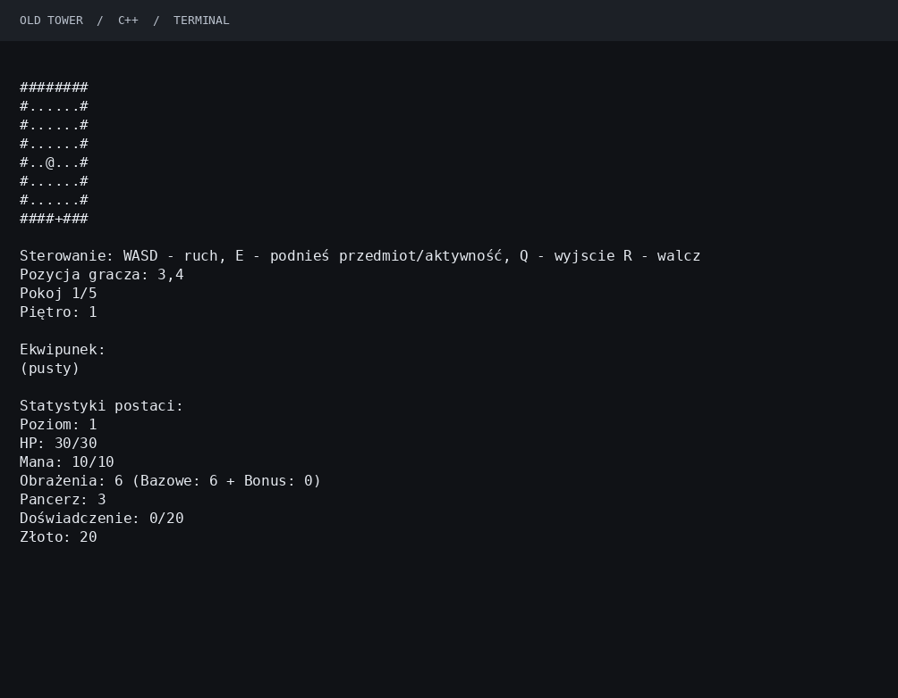
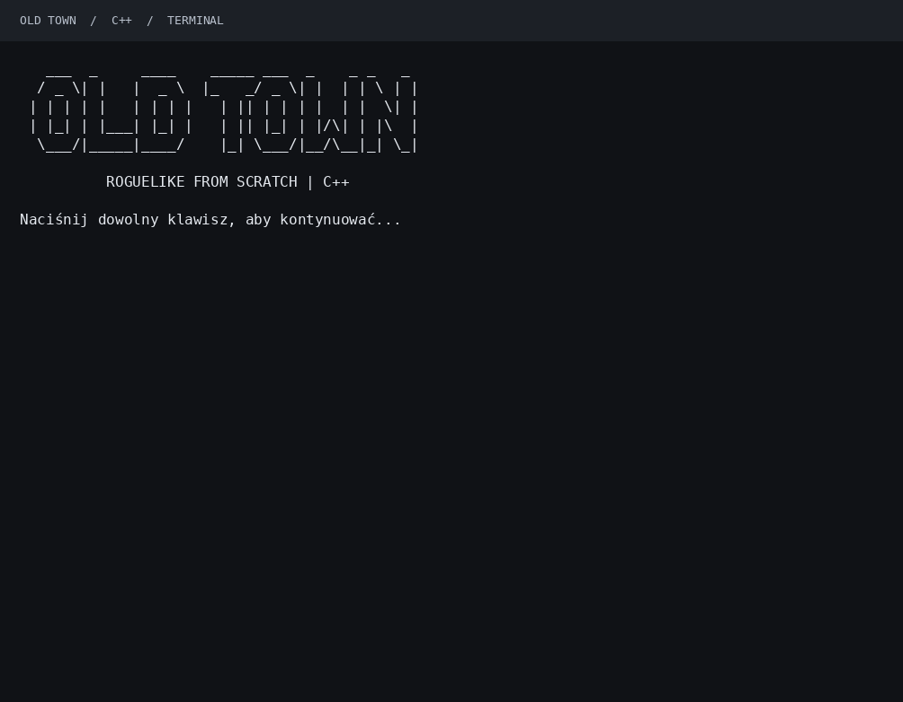
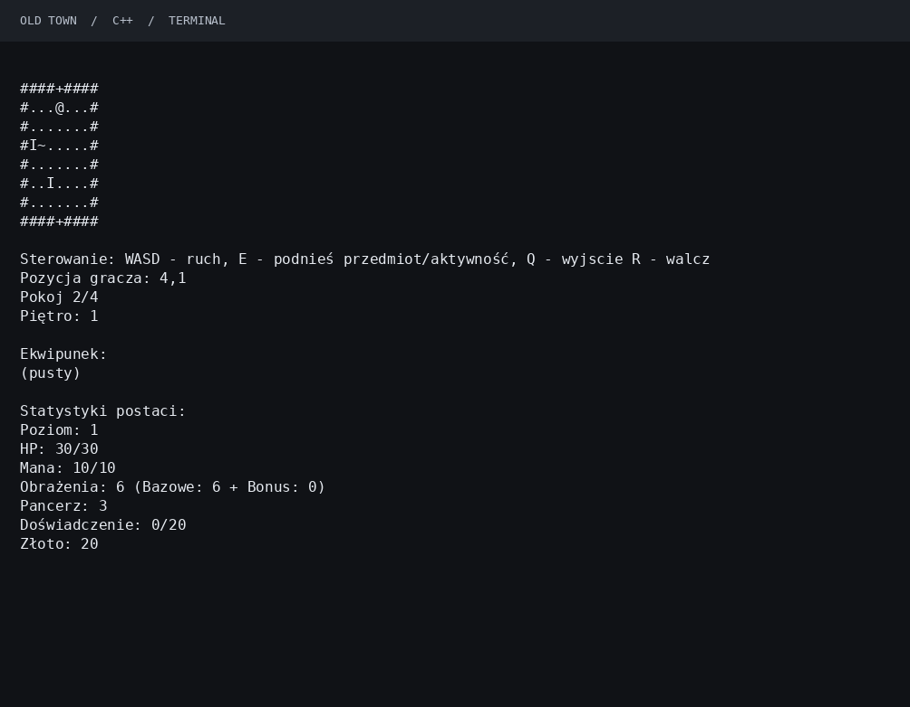
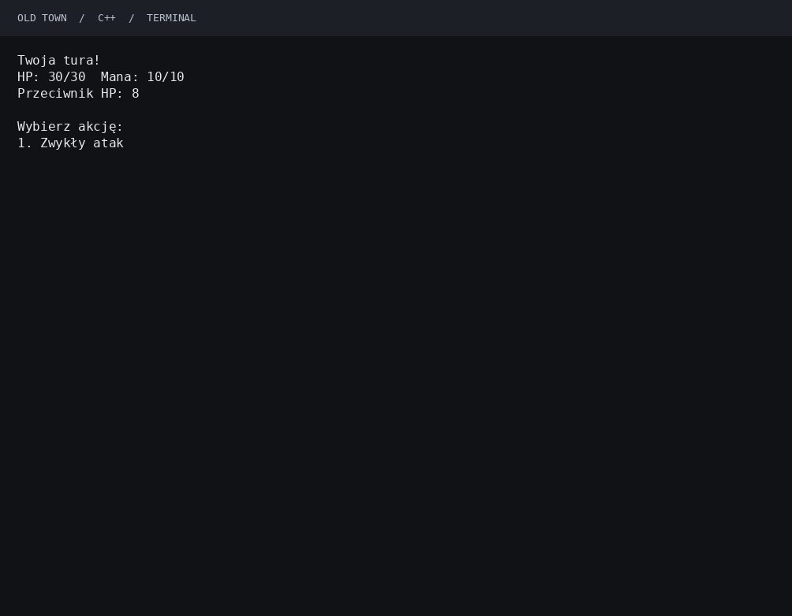

# Roguelike from Scratches — "Old Tower"

Prosta, konsolowa gra roguelike napisana od podstaw w **C++** jako projekt akademicki.
Celem było samodzielne zbudowanie logiki gry — bez gotowego silnika ani frameworka do tworzenia gier. Projekt korzysta z biblioteki standardowej C++ oraz systemowych funkcji obsługi terminala.

## Rozgrywka



*GIF przedstawia uruchomioną grę, przejście przez pokój startowy i eksplorację kolejnego pomieszczenia. Osobny zrzut poniżej pokazuje walkę turową.*

## Co zostało zaimplementowane

- Losowana liczba i wielkość pomieszczeń oraz przechodzenie między pokojami i piętrami.
- Gracz, przeciwnicy i bossowie z własnymi statystykami.
- Walka turowa: zwykły atak, umiejętności i zużywanie many.
- Ekwipunek, podnoszenie przedmiotów, sklep i zakupy za złoto.
- Punkty doświadczenia, poziomy postaci, zdrowie, mana, obrażenia i pancerz.
- Konsolowa reprezentacja mapy oraz obsługa wejścia z klawiatury.
- Interaktywny tryb testowy do sprawdzania map, przedmiotów, przeciwników i walki.

## Zrzuty ekranu

### Ekran tytułowy



### Eksploracja



### Walka turowa



Zrzuty pochodzą z działającej wersji konsolowej. Wygląd znaków może zależeć od czcionki i ustawień terminala.

## Uruchomienie

Wymagania: **CMake 3.16+**, kompilator z obsługą **C++17** (GCC, Clang lub MinGW-w64) i terminal UTF-8.

### Budowanie przez CMake

W katalogu projektu:

```bash
cmake -S . -B build -DCMAKE_BUILD_TYPE=Release
cmake --build build --config Release
```

Linux / macOS:

```bash
./build/old-tower
```

Windows z generatorem MinGW Makefiles:

```powershell
cmake -S . -B build -G "MinGW Makefiles" -DCMAKE_BUILD_TYPE=Release
cmake --build build
.\build\old-tower.exe
```

CMake kompiluje moduły z `src/` i udostępnia nagłówki z `include/`. Zrzuty ekranu i GIF są w `docs/images/`.

### Bez CMake — Linux / macOS

```bash
g++ -std=c++17 -O2 -pthread -Iinclude src/main.cpp src/*/*.cpp -o old-tower
./old-tower
```

Kompilację i materiały do README zweryfikowano na Linuksie. Kod obsługi konsoli dla Windows korzysta z WinAPI i funkcji MinGW; ten wariant nie był tutaj uruchamiany.

## Sterowanie

| Klawisz | Działanie |
| --- | --- |
| `W`, `A`, `S`, `D` | Ruch postaci |
| `E` | Podniesienie przedmiotu lub interakcja |
| `R` | Rozpoczęcie walki z pobliskim przeciwnikiem |
| `Q` | Zakończenie bieżącej rozgrywki |
| `1`, `2`, ... | Wybór opcji menu, akcji lub umiejętności |

## Organizacja kodu

Pliki implementacji znajdują się w `src/`, a odpowiadające im nagłówki w `include/`. Oba katalogi mają ten sam podział na moduły.

| Katalog w `src/` i `include/` | Zawartość |
| --- | --- |
| `core/` | Główna pętla gry, wejście i zmiany stanu (`Game`) |
| `entities/` | Gracz, istoty i przeciwnicy (`Player`, `Istota`, `Potwor`, `Potwory`) |
| `world/` | Mapa, pokoje, drzwi i obiekty świata (`Map`) |
| `systems/` | Walka, statystyki, losowania, umiejętności, przedmioty, ekwipunek i sklep |
| `platform/` | Obsługa terminala na różnych systemach i bufor konsoli |
| `debug/` | Interaktywny tryb testowy dostępny z menu gry (`Testy`) |

`src/main.cpp` zawiera punkt wejścia i menu. `CMakeLists.txt` definiuje sposób budowania projektu, a `docs/images/` przechowuje materiały do tego README.

## Cel edukacyjny

Projekt pozwolił przećwiczyć programowanie obiektowe, podział kodu na moduły, zarządzanie stanem rozgrywki, generowanie pomieszczeń oraz samodzielną implementację mechanik. To projekt edukacyjny prezentujący proces budowania prostej gry od podstaw.

**Autor: Dominik Zaręba.**
